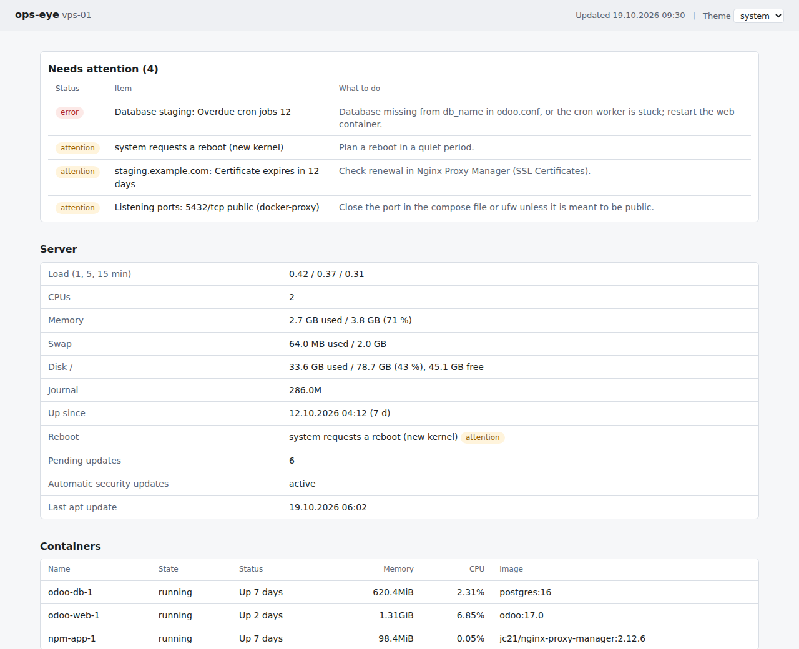
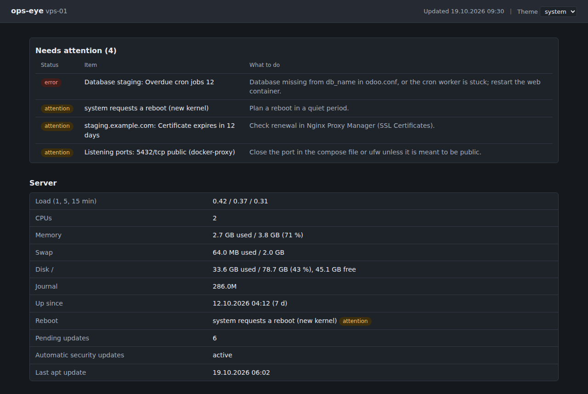
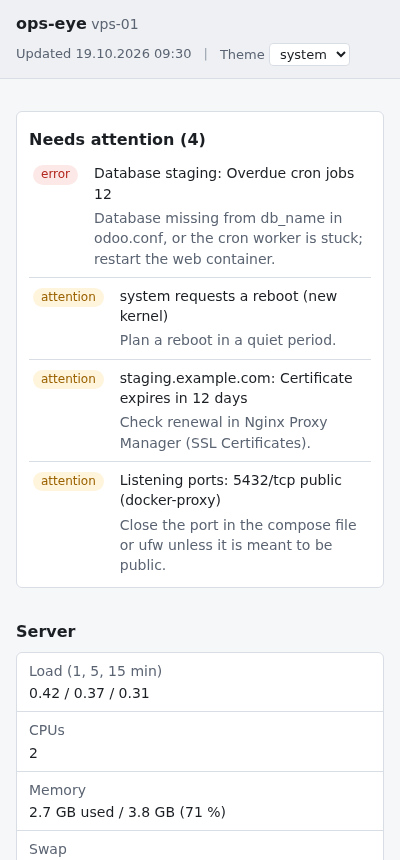

# ops-eye

[](https://github.com/darisfilovic/ops-eye/actions/workflows/ci.yml)

An operations view for a single Docker host that runs Odoo behind Nginx
Proxy Manager. One status page answers the question an administrator has
after a reboot, an upgrade or a quiet weekend: does anything need my
attention, and what do I do about it?

Around the page, the repository keeps everything else the host needed: a
Compose stack of proven monitoring tools, fail2ban jails that work for
Docker, nginx hardening for Odoo, and the host settings that keep logs
and disks under control. Nothing listens on a public address.

> This repository is published as a single commit. The tool was developed
> in a private repository together with the configuration of a production
> server that hosts client systems, and that history stays private for
> confidentiality reasons. The code here is the same tool, cleaned of client
> data.



*Example report with made-up data: host, domains, addresses and numbers are invented.*

## What the status page checks

`python3 -m opseye` collects the state of the host, writes a static page
and a JSON file, and prints the same report in the terminal with `--text`.
Items that need attention come first, errors before warnings, each with
the step that fixes it. When nothing needs attention, the page says so in
one sentence.

| Area | Checks |
|---|---|
| Server | load, memory, swap, disk, journal size, reboot flag, pending and automatic updates |
| Containers | every container with its state, memory and CPU |
| Odoo | overdue scheduled jobs per database, database size and connections, ERROR lines in the log, `/web/health` and certificate expiry per domain |
| Web traffic | requests of the last 24 hours from the NPM logs by status class, scanner hits, hits on the bare IP address, most active clients |
| Security | fail2ban jails, SSH logins by key and by password, listening ports with a warning for anything public other than 22, 80 and 443, domain registration expiry |
| Docker | space that can be reclaimed |

The page is plain HTML and CSS with a light and a dark theme, works at
phone width and loads nothing from the internet, so it still opens when
the network is the problem.

<p>
  
  
</p>

## Design decisions

- **Nothing is exposed.** Every service binds to `127.0.0.1` and is reached
  through an SSH tunnel. A monitoring tool on a public port is one more
  thing to defend.
- **A static page, no server-side application.** A systemd timer
  regenerates the page every five minutes and nginx serves the files. There
  is nothing to log in to and nothing to attack.
- **Standard library only.** The generator runs with the system Python
  3.10 or newer and has no dependencies to install or patch on the host.
- **Proven tools do the heavy lifting.** GoAccess, Beszel, fail2ban-dashboard,
  Portainer and Cockpit already do traffic, metrics, bans and container
  management well. ops-eye adds the glue and the one page that ties them
  together.
- **A failing check does not hide the others.** Every collector runs on its
  own; when a command is missing or fails, the page lists that and shows
  everything else.
- **Parsing is separate from collecting.** Commands run in `collectors.py`;
  their output is read by pure functions in `parsers.py`, which are tested
  against samples of real output.
- **Nothing destructive by default.** The host installer is a dry run until
  `--apply`, the SSH settings are applied by hand, and the weekly cleanup
  only lists orphaned Odoo files until it is told to remove them.

## Lessons from running it in production

The tool ran on a production VPS with several Odoo databases from
September to October 2026. Much of the host configuration exists because
of something that went wrong there.

- **fail2ban bans did nothing for Docker.** The stock actions write into
  the `INPUT` chain, but traffic to a published container port goes
  through `PREROUTING` and `FORWARD`. Bans showed up in
  `fail2ban-client status` while the addresses kept getting through. The
  action in `host/fail2ban/action.d/iptables-docker.conf` writes into
  `DOCKER-USER`, which Docker evaluates first.
- **The scanner jail missed what nginx blocked.** When nginx answers a
  request itself, with a redirect or with 444 for a scanner, Nginx Proxy
  Manager logs the upstream status as `-`. The filter expected a number.
  Found while preparing this release: on the production logs it matched
  11 of 869 scanner requests of one host. The fixed filter is tested the
  way fail2ban applies it (`tests/test_fail2ban_filters.py`).
- **A renamed database silently stopped all its scheduled jobs.** Odoo
  runs cron only for the databases listed in `db_name`. After a rename, 44
  of 47 jobs of one database sat overdue (mail, OCR, recurring invoices)
  with no error anywhere. The cron backlog per database is now the first
  thing the page checks.
- **Odoo bundles travelled uncompressed.** Nginx Proxy Manager enables gzip
  for `text/html` only, so every 2 to 3 MB JavaScript bundle and every
  JSON-RPC answer went out as is. `nginx/npm/http_top.conf` fixes that for
  all hosts.
- **The journal grew to 4 GB.** Without a limit, journald keeps everything.
  `host/journald/ops-eye.conf` caps it at 300 MB and one month.

## Repository layout

```
opseye/            status page generator (python3 -m opseye)
  collectors.py    run the commands, one function per section
  parsers.py       read the output of journalctl, ss, fail2ban-client, whois, NPM logs
  render.py        HTML page and terminal report
  report.py        sections, attention list, severities, JSON form
  i18n.py          interface text in English and Bosnian
  static/          style.css and theme.js
bin/               ops-eye command and first-run setup of Portainer and Beszel
host/              files for /etc: fail2ban, journald, logrotate, sysctl, sshd,
                   Docker log limits, systemd timers, weekly cleanup, Cockpit
nginx/npm/         include files for Nginx Proxy Manager and the Advanced block for Odoo hosts
tests/             pytest suite and an example report with made-up data
docs/INSTALL.md    step by step installation on a new server
```

## Running it

On an Ubuntu host with Docker Compose v2, Python 3.10 or newer, fail2ban,
whois and iproute2:

```
cp .env.example .env         # log paths, Odoo containers and databases, domains
bin/ops-eye up               # GoAccess, Beszel, fail2ban-dashboard, Portainer, status page
bin/ops-eye setup            # one generated password for Portainer and Beszel, stored in .env
bin/ops-eye install-timer    # refresh the status page every five minutes
bin/ops-eye check            # the same report in the terminal
```

Then, from your own computer:

```
ssh -L 8092:127.0.0.1:8092 -L 7880:127.0.0.1:7880 -L 8090:127.0.0.1:8090 \
    -L 8091:127.0.0.1:8091 -L 9000:127.0.0.1:9000 user@server
```

and open `http://127.0.0.1:8092/`. The Ports tab of VS Code Remote SSH
forwards the same ports.

| Service | Purpose | Port |
|---|---|---|
| status page | what needs attention, and the state of everything else | 8092 |
| GoAccess | traffic over time, status codes, 404 paths, crawlers, countries, per host | 7880 |
| Beszel | CPU, memory, disk and network history per host and container, alerts | 8090 |
| fail2ban-dashboard | banned addresses per jail | 8091 |
| Portainer CE | containers, images, volumes and logs | 9000 |
| Cockpit (optional) | updates, services and the journal in the browser | 9090 |

[docs/INSTALL.md](docs/INSTALL.md) covers the host configuration, the
nginx includes, GeoIP updates and removal.

## Development

```
pip install -r requirements-dev.txt
ruff check . && ruff format --check .
pytest
```

The page can be rendered from a saved report without touching the host,
which is how the screenshots above were made:

```
python3 -m opseye --from-json tests/fixtures/status-example.json --out out
python3 tools/screenshots.py file://$PWD/out/index.html
```

CI runs ruff and pytest on Python 3.10 and 3.12, shellcheck on every
script, validates both Compose files, and scans every commit for secrets
with gitleaks.

## License

Copyright (c) 2026 Daris Filovic. All rights reserved.

The source code is published to be read. Using, copying, modifying,
distributing or selling it, in whole or in part, requires written
permission from the author. See [LICENSE](LICENSE).
